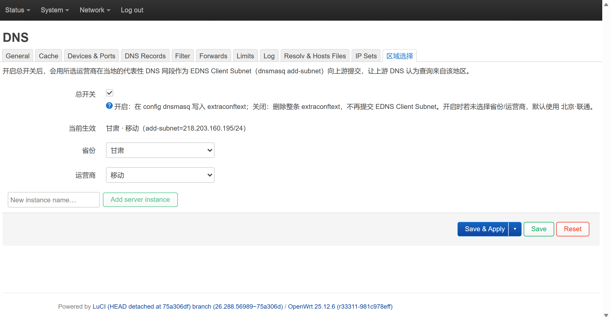

# luci-app-region-select

给 OpenWrt 的 LuCI 界面加一个 **区域选择** 选项卡：按「省份 + 运营商」选一个代表性 DNS 网段，
通过 dnsmasq 的 `add-subnet`（EDNS Client Subnet）向上游 DNS 声明来源子网，让上游认为你的查询来自该地区。

入口在 **网络 → DNS** 的最后一个标签页。



---

## 特性

- **31 个省级行政区 × 4 家运营商**（联通 / 移动 / 电信 / 广电），共 124 组网段
- **总开关**：开启时写入 `extraconftext`，关闭时整条删除，不留残留
- 进入页面**自动选中**当前生效的省份与运营商
- 保存后**自动重启 dnsmasq**（`reload` 不重读配置，必须 `restart`）
- 一键安装 / 一键卸载，卸载时把 `dns.js` **字节级还原**为系统原文件
- 不依赖任何额外软件包，只用 BusyBox 自带的 `awk` / `sed`

## 适用环境

| 项目 | 版本 |
|---|---|
| OpenWrt | 25.12.x（apk-tools 3） |
| LuCI | 26.288 的 `view/network/dns.js` |
| dnsmasq | 2.93 |

已在 **OpenWrt 25.12.6 (r33311-981c978eff) / LuCI 26.288.56989 / dnsmasq 2.93 (x86_64)** 上实测通过。

> 其他 LuCI 版本（21.x / 22.x / 23.x / 24.x）的 `dns.js` 结构不同，安装脚本会因为找不到锚点而中止，不会写坏文件。

## 安装

**一条命令**（需要 root）：

```sh
wget -qO- https://raw.githubusercontent.com/GnuTuxWrt/luci-app-region-select/main/luci-app-region-select.sh | sh
```

**或者**先下载再执行（想先看看内容的话推荐这种）：

```sh
wget -O /tmp/rs.sh https://raw.githubusercontent.com/GnuTuxWrt/luci-app-region-select/main/luci-app-region-select.sh

sh /tmp/rs.sh             # 安装
sh /tmp/rs.sh status      # 查看状态
sh /tmp/rs.sh uninstall   # 卸载
```

安装过程会重启 `rpcd`，**Web 会话会掉线**，重新登录 LuCI 即可。

### 为什么没有 `.ipk` / `.apk`？

OpenWrt 25.12 用的是 **apk-tools 3**，包格式是 **ADB v3**（文件头 `ADBd`），
只能由 OpenWrt SDK 交叉编译产出；`.ipk` 是旧版 opkg 的格式，`apk add` 会直接报：

```
ERROR: xxx.ipk: file format is invalid or inconsistent
```

所以这里用「自解压 shell 脚本」分发：一个文件、一条命令，同样可以一键安装和卸载。

## 使用

1. 打开 **网络 → DNS**，切到最右边的 **区域选择** 标签
2. 勾选 **总开关**
3. 选择 **省份** 和 **运营商**
4. 点 **Save & Apply**
5. 等 1~2 秒，`当前生效` 会显示 `省份 · 运营商（add-subnet=x.x.x.x/24）`

> 总开关打开但没有选省份/运营商时，会默认使用 **北京 · 联通**。

### 确认真的生效了

```sh
# 1. 配置项是否写入
uci get dhcp.@dnsmasq[0].extraconftext
# 期望：add-subnet=218.203.160.195/24 之类

# 2. dnsmasq 实际读取的附加配置
cat /tmp/dnsmasq.*.d/extraconfig.conf

# 3. 进程有没有重启（每次保存 PID 都会变）
pgrep -x dnsmasq
```

## 卸载

```sh
sh /tmp/rs.sh uninstall
```

会做三件事：

- 用安装时备份的 `/usr/share/luci-app-region-select/dns.js.orig` 还原 `dns.js`
- 删除 `region-select-data.js` 与 ACL 文件
- 去掉 `/etc/sysupgrade.conf` 里登记的 3 行

**不会**动 `/etc/config/dhcp` 里的 `extraconftext`。如果要连 ECS 一起关掉：

```sh
uci delete dhcp.@dnsmasq[0].extraconftext
uci commit dhcp
/etc/init.d/dnsmasq restart
```

## 工作原理

安装后的文件变化（也是这个项目对系统的**全部**改动）：

| 类型 | 路径 | 说明 |
|---|---|---|
| 新增 | `/www/luci-static/resources/region-select-data.js` | 31×4 映射表 + 读写辅助函数 |
| 新增 | `/usr/share/rpcd/acl.d/luci-app-region-select.json` | 允许页面调用 `/etc/init.d/dnsmasq restart` |
| 修改 | `/www/luci-static/resources/view/network/dns.js` | 加 1 行 `require`，并在 `render()` 尾部插入选项卡 |
| 修改 | `/etc/sysupgrade.conf` | 登记上面三个文件，系统升级时保留 |
| 备份 | `/usr/share/luci-app-region-select/dns.js.orig` | 仅安装期间存在，卸载时用来还原 |

`dns.js` 不是整文件替换，而是按 `files/dns.js.diff` 的补丁打的：

```js
// 1) 在 require 链上追加
'require region-select-data as rs';

// 2) 在 render() 的 return m.render() 之前插入代码块
/* >>> luci-app-region-select begin >>> */
...
/* <<< luci-app-region-select end <<< */
```

两个位置都是幂等的，重复安装不会插两次。

### 几个踩过的坑（供参考）

- **为什么要 restart 而不是 reload**：`/etc/init.d/dnsmasq reload` 只做 `rc_procd start_service` + `procd_send_signal`，
  也就是发 SIGHUP；dnsmasq 收到 SIGHUP **不会重读配置文件**，`add-subnet` 不会生效。
- **为什么要等配置落盘再重启**：LuCI 的 `uci.save()` 只是暂存，真正写 `/etc/config/dhcp` 发生在 Save & Apply 触发的
  `uci apply`。如果保存完立刻重启，dnsmasq 读到的还是旧配置。
- **为什么要删 extraconfig.conf**：init 脚本只写了 `[ -n "$extraconftext" ] && echo ... > extraconfig.conf`，
  从不清空它；关闭开关后旧文件会残留并继续生效。
- **为什么需要单独的 ACL 文件**：`luci-base` 只给了 `file: list`，没有 `file exec`，页面里的重启命令会被 rpcd 拒绝。

## 数据说明

- 每个省份、每家运营商取一个**公开的递归 DNS 地址**，截取 `/24`
- **广电**多数省份没有公开 DNS 记录，用同省**移动**网段兜底（广电 5G 与移动共建共享）
- 山西电信、西藏电信等少数条目使用了邻近省份/同省移动的网段，`region-select-data.js` 里有注释
- 这些是「代表性网段」，作用是让上游判断归属地，**不保证精确到城市**

## 常见问题

**Q: 点了 Save & Apply 但没变化？**
先看 `pgrep -x dnsmasq` 的 PID 有没有变。没变说明重启失败，常见原因是 ACL 文件没装上或 `rpcd` 没重启，
执行 `sh rs.sh status` 看一眼，再 `sh rs.sh install` 重装一次。

**Q: 关掉总开关后，上游还是看到旧的 add-subnet？**
旧版本的问题（没删 `extraconfig.conf`）。用当前版本重装后再试。

**Q: 上游 DNS 真的会按这个子网返回结果吗？**
取决于上游是否支持 ECS 以及是否按 ECS 分流（阿里、腾讯、114 等公共 DNS 基本都支持）。
这只影响「被认为来自哪里」，不改变你的实际出口 IP。

**Q: 能不能只选到城市？**
目前只做到省级。

## License

[MIT](LICENSE)
